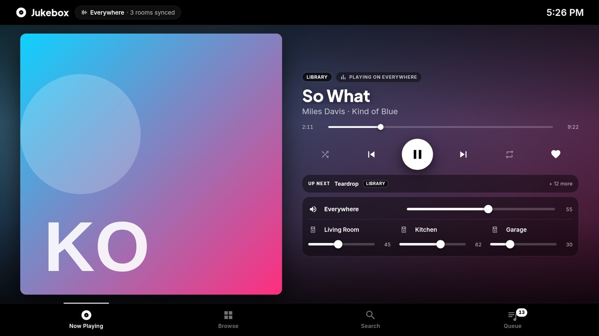
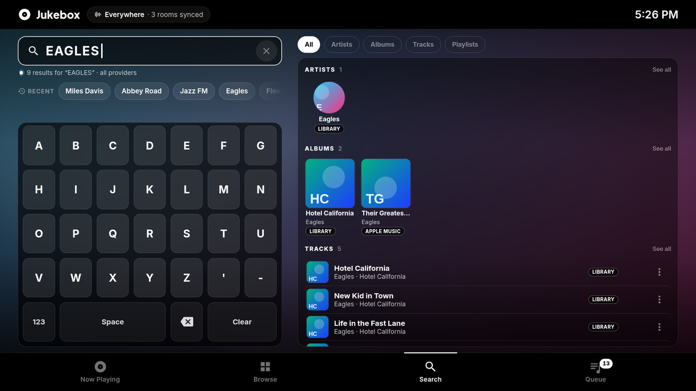
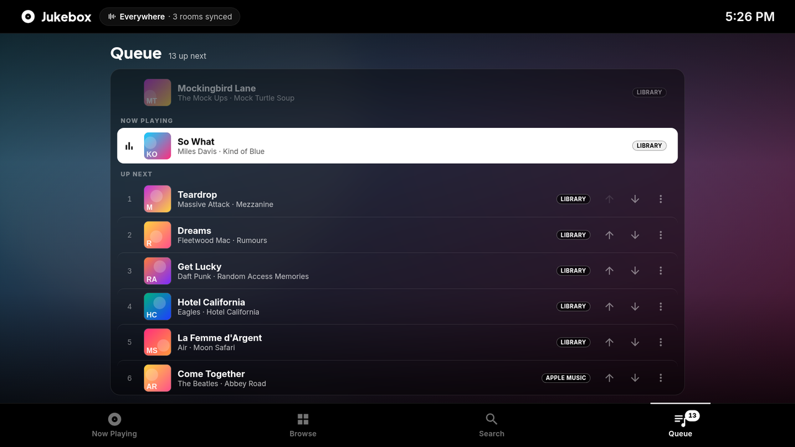
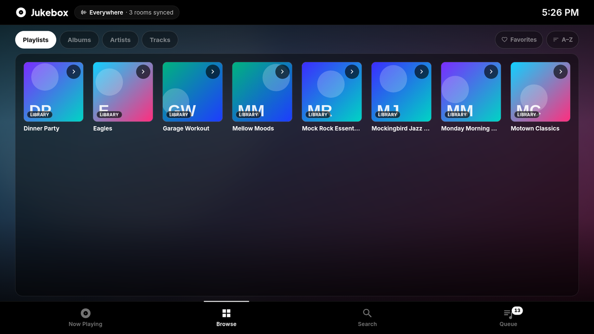
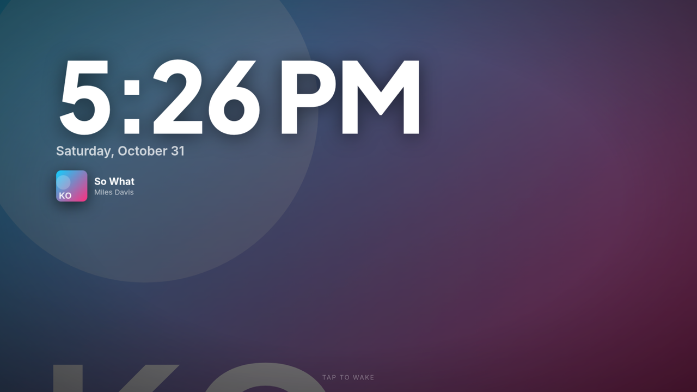
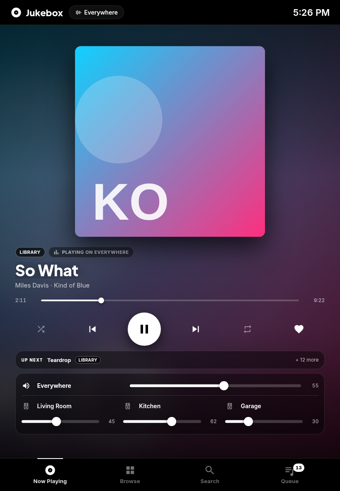
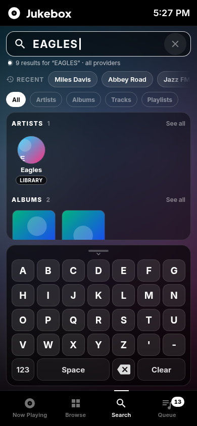
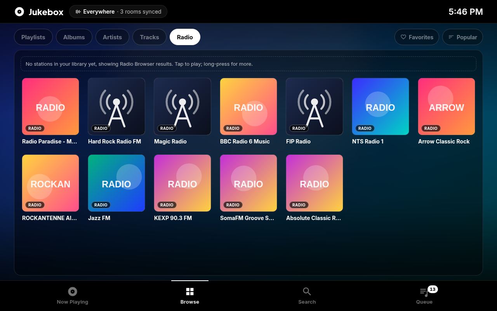
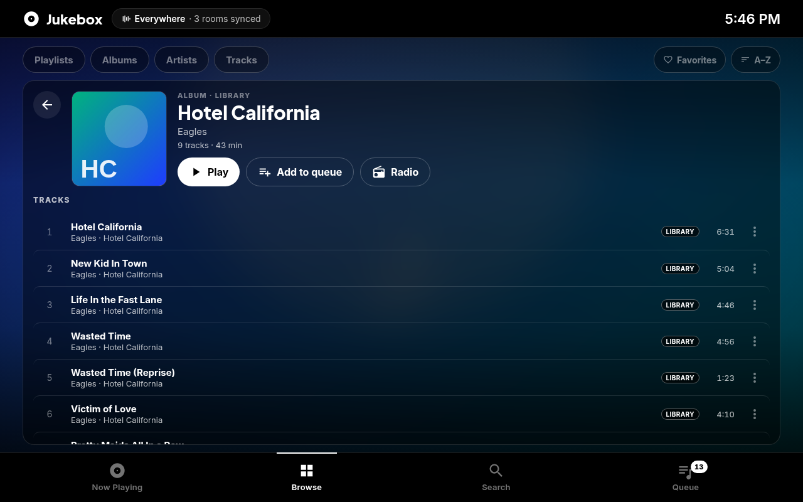
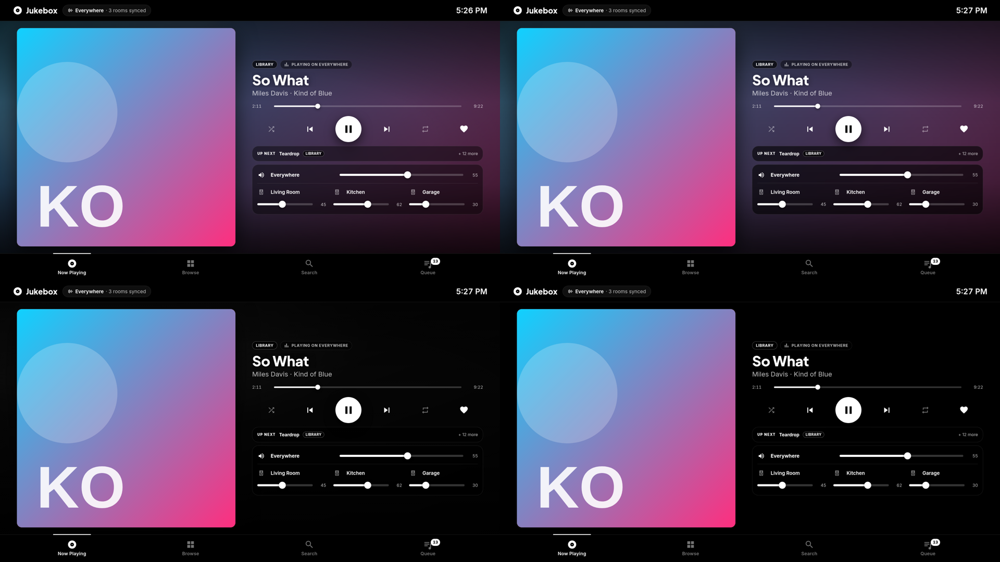

# Jukebox Card (`ha-jukebox-kiosk-card`) 0.4.0

This is a Lovelace custom card for a Home Assistant + Music Assistant jukebox kiosk. It uses the Black Frame Mono look: black header and footer, the album art blurred behind the centre, white active buttons and light-white inactive ones.



| Search (on-screen keyboard, results per keystroke) | Queue |
|---|---|
|  |  |
| **Browse** | **Screensaver** |
|  |  |
| **Portrait tablet (820x1180)** | **Phone (390x844)** |
|  |  |
| **Browse > Radio (1280x800)** | **Album with durations (1280x800)** |
|  |  |

**What it has:**
- all five tabs: **Now Playing**, **Browse**, **Search**, **Queue** and **Lyrics**
- lyrics from Music Assistant (synced or plain) on the art, a full-screen Stage, the Lyrics tab and the screensaver (see [Lyrics](#lyrics))
- the screensaver
- the card shell (header, rooms pill, clock, tab bar with a queue badge)
- backdrop performance modes for slow kiosk tablets (see [Backdrop and performance](#backdrop-and-performance))
- automatic large-screen scaling (1920x1080 and up)

Search has no text input. You type on the on-screen keyboard, which works like the YouTube app on Android TV or a TouchTunes jukebox, and the results update on every keystroke.

Nothing in this repository talks to a real Home Assistant server. Development and tests run against `dev/mock-hass.js`.

The repository is `randybell/ha-jukebox-kiosk-card`. The card's element is `custom:jukebox-card`, and its file is `jukebox-card.js`.

## Build

```bash
# lit 3, rollup 4, typescript 5.9 (TS 7 breaks @rollup/plugin-typescript), fontsource
npm ci                # or npm install
npm run build         # -> dist/jukebox-card.js (single ES module) + dist/fonts/*
npm run watch         # rebuild on change
npm run typecheck     # tsc --noEmit
```

## Dev harness and tests (no Home Assistant needed)

```bash
python3 -m http.server 8765 --bind 127.0.0.1     # from the project root; the harness won't run from file://
# open http://127.0.0.1:8765/dev/index.html?log=1
npm test                                           # run.mjs (156 end-to-end checks) + lyrics unit tests (51) + lyrics end-to-end checks (75) (puppeteer-core + /usr/bin/google-chrome; CHROME=... to override)
node test/shots-m2.mjs f1                          # every tab at 1920x1080, 1280x800, 820x1180 and 390x844 -> test/shots/m2/
JB_SIZES=1920x1080 node test/shots-m2.mjs x1 '&backdrop=light'   # one size, one mode
node test/shots-v040.mjs                           # lyrics surfaces, states and the editor at 1280x800, 1920x1080, 390x844 -> test/shots/v040/
node test/perf.mjs 3                               # frame-time benchmark, see "Backdrop and performance"
```

`dev/mock-hass.js` is a fake `hass`. It uses the shapes from the real exports (`dev/fixtures/`):
- `search` always returns the 7 lists.
- Items carry no provider field; the provider comes from the URI scheme (`library://`, `apple_music://`, `apple_music--XXXXXXXX://`).
- `get_library` returns `{items, limit, offset, order_by, media_type}` with `library://` URIs.
- `mass_queue.get_queue_items` returns a list keyed by entity.
- `mass_queue.get_album_tracks` / `get_playlist_tracks` return the real 0.10.x shape (`{tracks: [{media_title, media_artist, media_album_name, media_content_id, media_image, duration, favorite, position}]}`); `library://album/1448` and `library://playlist/158` answer with the real exports in `dev/fixtures/mass-queue-tracks-sample.json`.
- The player has an absolute `entity_picture` (`http://<ma-host>:8095/imageproxy?…`) and a relative `entity_picture_local`, as on the real system.
- The fixtures are scrubbed: provider instance ids are `--XXXXXXXX`, HA context ids are placeholders and `user_id` is `null`.
- `play_media` is rejected unless the target is `media_player.everywhere`.
- Every service call changes the mock state and pushes a new `hass`, as HA does.

URL parameters:

| Parameter | Effect |
|---|---|
| `latency=ms` / `jitter=ms` | reply latency and its random variation |
| `mode=inverse` | shorter queries reply more slowly, which forces out-of-order replies |
| `fail=1` | the mock search fails |
| `real=1` | search returns the real "eagles" export from `dev/fixtures/ma-search-sample.json` |
| `radio=1` | Radio Browser stations in search only (library radio stays empty, so Browse > Radio uses the search fallback) |
| `radio=lib` | the same stations also in the library (`get_library media_type: radio`) |
| `mqpage=all\|paged\|ignore` | how `get_*_tracks` treats `page`: `all` (default, mass_queue 0.10: page 0 = everything), `paged` (50 per page), `ignore` (every page returns the same list) |
| `noart=1` | the player has no `entity_picture_local`, so art falls back to the queue item's https image |
| `legacyq=1` | configures the old `queue_config_entry_id` key instead of `mass_queue_entry_id` |
| `idle=1` / `paused=1` | nothing playing / paused |
| `empty=1` | empty library and queue |
| `qfail=1` | `mass_queue.get_queue_items` fails |
| `noqueue=1` | no `mass_queue_entry_id`, so drill-down uses the search fallback |
| `saver=min` | `screensaver_minutes`; for example `saver=0.05` is 3 seconds |
| `recents=1` | seeds the recent-search chips |
| `fresh=1` | clears localStorage |
| `log=1` | shows a panel with every `callService` call |
| `tab=now\|browse\|search\|queue\|lyrics` | opens that tab (default `now`) |
| `lyrics=none` | every lyrics lookup finds nothing |
| `lyrfail=perm\|err` | lyrics lookups fail with a permission error / a generic error |
| `lyrlat=ms` | lyrics reply latency (the live first lookup takes 8–33 s) |
| `overlay=1\|0` | preset the art lyrics overlay toggle |
| `keeplyrics=1` | with `fresh=1`, keep the lyrics cache |
| `cfg=<json>` | merged into the card config |
| `backdrop=auto\|full\|light\|static\|off` | sets the `backdrop` option |

Every call is recorded in `window.__calls`, except read-only lyrics lookups (`mass_queue.send_command`), which go to `window.__lyricsLog`. `window.__setNowPlaying({artist, title, radio, uri, duration, position})` and `window.__playTrack(name, position)` change what is playing. `test/run.mjs` drives the card with real CDP mouse, touch and keyboard input and writes `test/shots/results.json`. The browser tests are hermetic (`test/intercept.mjs`): `/api/media_player_proxy/…` and https images are answered with a generated SVG, and any request to a plain-http host other than the dev server fails (test 16o checks that the card never asks the MA host directly).

## Install on Home Assistant (nothing here touches your server)

### HACS

1. HACS → ⋮ → **Custom repositories** → `https://github.com/randybell/ha-jukebox-kiosk-card`, category **Dashboard**.
2. Install **Jukebox Card**. HACS downloads `jukebox-card.js` from the latest GitHub release (built by `.github/workflows/release.yml` when a `v*` tag is pushed) and adds the resource `/hacsfiles/ha-jukebox-kiosk-card/jukebox-card.js`.
3. Fonts: HACS only downloads `.js` files, so without fonts the card uses the system UI font. For the intended Inter / Plus Jakarta Sans, unzip `jukebox-card-fonts.zip` from the same release into `/config/www/jukebox/fonts/` and set `font_base: /local/jukebox/fonts`.

### Manual

1. Download `jukebox-card.js` and `jukebox-card-fonts.zip` from a release (or run `npm run build`) and put them in `/config/www/jukebox/` as `jukebox-card.js` and `fonts/`.
2. Add the resource under **Settings → Dashboards → ⋮ → Resources**: URL `/local/jukebox/jukebox-card.js?v=0.4.0`, type **JavaScript module**.
   - Change `?v=` on every update, or Fully Kiosk will keep the old file.
   - Fonts are found in `fonts/` next to the `.js` automatically.

### Dashboard

Make a dashboard with a single **panel** view:

```yaml
views:
  - title: Jukebox
    path: jukebox
    type: panel
    cards:
      - type: custom:jukebox-card
        entity: media_player.everywhere                # MA group player; every play_media goes here
        config_entry_id: <music assistant entry id>    # Settings → Devices & services → Music Assistant (id is in the URL)
        mass_queue_entry_id: <mass_queue entry id>     # optional, enables album/artist/playlist track lists
        favorite_entity: button.everywhere_favorite_current_song
        rooms:
          - { name: Living Room, entity: media_player.living_room }
          - { name: Kitchen,     entity: media_player.kitchen }
          - { name: Garage,      entity: media_player.garage }
        screensaver_minutes: 10
        default_tab: now                               # now | browse | search | queue | lyrics
        show_lyrics: true                              # needs mass_queue_entry_id
        backdrop: auto                                 # full | light | static | off | auto
```

### Options

| key | default | |
|---|---|---|
| `entity` | `media_player.everywhere` | Player for transport, the Everywhere volume, the queue and every `play_media` |
| `config_entry_id` | (required) | MA config entry for `music_assistant.search` / `get_library` |
| `rooms` | `[]` | `[{name, entity, icon?}]`, or bare entity ids (the name then comes from `friendly_name`). Each room gets its own volume slider |
| `favorite_entity` | `button.everywhere_favorite_current_song` | Pressed by the heart (button, input_button or script). `''` hides the heart |
| `mass_queue_entry_id` | — | mass_queue (Music Assistant Queue Actions) config entry, used for `mass_queue.get_album_tracks / get_artist_tracks / get_playlist_tracks` and for lyrics (`mass_queue.send_command`). The 0.3.0 name `queue_config_entry_id` is still accepted, and the visual editor rewrites it to the new key |
| `screensaver_minutes` | `10` (0–1440) | Idle minutes before the screensaver. `0` turns it off. The editor offers Off, 1, 5, 10, 15, 30, 60 and Custom; any 0–1440 value from YAML still loads |
| `browse_limit` | `60` (1–500) | Items per Browse page (infinite scroll pages by `offset`) |
| `queue_limit` | `200` (1–1000) | Upcoming items requested from `get_queue_items` (`limit_after`); out-of-range values are clamped |
| `limit` | `8` (1–50) | Search results per type. 1-character queries always use 5 |
| `default_tab` | `now` | `now`, `browse`, `search`, `queue` or `lyrics`. A tab that is turned off (or unknown) is ignored and Now Playing opens |
| `library_only` | `false` | Search only the MA library |
| `slow_ms` | `800` | Search replies slower than this switch on in-flight limiting |
| `accent` | `mono` | Only `mono` exists so far |
| `font_base` | `fonts/` next to the `.js` | Location of the woff2 files. `false` uses system fonts |
| `height` | `100dvh` | Card height; use a fixed px value outside panel views |
| `backdrop` | `auto` | `full`, `light`, `static`, `off` or `auto`. See [Backdrop and performance](#backdrop-and-performance) |
| `scale` | `auto` | Large-screen zoom. `auto` scales the whole UI by min(width/1420, height/800) once that is ≥ 1.15 (1920x1080 → 1.35, capped at 1.8). A number forces it; `1` turns it off |
| `title` | `Jukebox` | Brand text in the header |
| `show_lyrics` | `true` | Master switch for lyrics: art overlay toggle, Stage, Lyrics tab and screensaver lyrics. Needs `mass_queue_entry_id` |
| `lyrics_tab` | `true` | Show the 5th **Lyrics** tab |
| `screensaver_lyrics` | `true` | Previous / current / next line (synced) or a slow scroll (plain) on the screensaver |
| `lyrics_seek` | `true` | Long-press (0.55 s) a synced line to seek there. Never on radio |
| `lyrics_offset_ms` | `500` (−5000–5000) | Shift for synced lyrics; positive shows lines sooner |

The visual editor covers entity, config entry, rooms (an entity list that keeps existing names), favorite entity and mass_queue entry; a **Display** section (screensaver presets Off / 1 / 5 / 10 / 15 / 30 / 60 min plus Custom, screensaver lyrics, default tab, backdrop, accent); a **Lyrics** section (lyrics, Lyrics tab, long-press seek, offset); and an Advanced section (browse limit and the rest). Options you leave at their defaults are not written to YAML, and existing 0.3.x configs load unchanged.

## Backdrop and performance

The full look puts a 38 px live blur of the album art behind the whole centre and a `backdrop-filter` blur behind every panel (14–18 px). That is cheap on a desktop GPU but expensive on low-end kiosk tablets, because the blurred layers have to be re-rastered whenever anything on top of them changes (a slider knob, a key press, a new search result). The `backdrop` option picks a cheaper look:

| `backdrop` | Centre backdrop | Panels (rooms, queue, search results, keyboard) |
|---|---|---|
| `full` | live CSS `filter: blur(38px) saturate(1.15)` of the full-size art | translucent + `backdrop-filter: blur(14–18px)` |
| `light` | the art drawn **once per track change** into a 64 px canvas (downscaled to 10 px, then smooth-upscaled and lightly blurred), stretched by the compositor; no CSS filter | solid `rgba(0,0,0,0.6)`, no `backdrop-filter` |
| `static` | a dark gradient, no art | solid `rgba(0,0,0,0.6)` |
| `off` | pure black | solid `rgba(0,0,0,0.6)` |
| `auto` (default) | `light` if `navigator.hardwareConcurrency <= 4`, or `navigator.deviceMemory <= 2`, or `prefers-reduced-motion: reduce`; otherwise `full` | |

- The resolved mode and the reason are on the element: `<jukebox-card data-backdrop="light" data-backdrop-why="hardwareConcurrency=4">`. Use this to check what a Fully Kiosk tablet picked (Fully's remote admin → "Get page source" or a remote DevTools session).
- `light` needs no CORS: drawing a cross-origin image into a canvas is allowed as long as nothing reads the pixels back, and the card never does. If an image fails to load, the canvas stays hidden and the gradient shows.
- `light` redraws only when the art URL changes or the screen's aspect ratio changes, never on slider drags or key presses (test 15c).
- Theme overrides: `--jb-panel-filter` (default `blur(14px)`, `none` in non-full modes) and `--jb-surface` / `--jb-panel-solid` for the panel colour.
- The screensaver shows the art (unblurred, so no filter cost) in `full` and `light`, and plain black in `static` and `off`.

**Reduced motion.** With `prefers-reduced-motion: reduce` (Android: Settings → Accessibility → Remove animations), `auto` picks `light`, and the screensaver turns off its Ken Burns zoom and its continuous drift. To still protect the panel from burn-in, the clock block jumps to a new position every 60 s with no animation (`step-end`), cycling through 10 spots over 10 minutes.

**Measured** with `node test/perf.mjs 3` in headless Chrome at 1920x1080 with a 4x CPU throttle (CDP `Emulation.setCPUThrottlingRate`), means of 3 runs of about 6.4 s each. Frame times are in ms.

| Scenario | avg | p95 | max | frames >33 ms | long tasks | main-thread ms | raster/GPU ms |
|---|---|---|---|---|---|---|---|
| slider drag, `full` | 16.7 | 16.8 | 16.8 | 0% | 0 | 665 | 190 |
| slider drag, `light` | 16.7 | 16.7 | 16.8 | 0% | 0 | 692 | 175 |
| keyboard typing, `full` | 16.8 | 16.8 | 44.5 | 0.3% | 0 | 1701 | 1438 |
| keyboard typing, `light` | 16.8 | 16.7 | 33.3 | 0% | 0 | 1706 | 407 |



*Top: `full`, `light`. Bottom: `static`, `off`.*

- Frame times are `requestAnimationFrame` deltas; long tasks come from a `PerformanceObserver('longtask')`; main-thread and raster/GPU time come from a CDP trace (`ThreadControllerImpl::RunTask` on the renderer main thread vs. compositor, raster and GPU threads).
- The main thread is not the bottleneck in either mode: no long tasks and a steady ~16.7 ms at 4x throttle. The blur cost is in raster/GPU work, which CPU throttling does not slow down, and on this box's fast CPU it still fits in a frame. The useful number is raster/GPU time, which is where a slow tablet's GPU drops frames. Typing (results re-rendering over a blurred backdrop) costs about 3.5x more raster/GPU time in `full` than in `light`.
- Re-check on the real tablet: open the dashboard with `backdrop: full`, then `light`, and compare how smooth the volume drag and typing feel. If `auto` picked `full` on a weak tablet, set `backdrop: light` explicitly.

## Large screens (1920x1080)

The layout is designed around a 1280x800 tablet. On larger screens the whole card is zoomed (CSS `zoom`, set from a `ResizeObserver`) so the art, text and touch targets grow, rather than spreading out with empty space. At 1920x1080 the zoom is 1.35, which gives the 1280x800 layout's proportions at full resolution. Popover menus correct their position for the zoom (`localRect` in `src/shared.ts`; test 15k). Use `scale: 1` to turn this off, or a number to force a size.

## Now Playing

- **Art.** The card never loads the player's absolute `entity_picture` (`http://<ma-host>:8095/imageproxy?…` is mixed content on an https dashboard and unreachable off the LAN). It uses, in order: `entity_picture_local` (HA's relative `/api/media_player_proxy/…` URL), a relative `entity_picture`, the current mass_queue item's https `media_image`, then the placeholder. The same URL feeds Now Playing, both backdrops (`full` and `light`) and the screensaver. Radio streams with no art get a radio-tower image. Item images are used only when they are https, `data:image` or relative.
- **Display.** The album art is blurred behind the card. The tab shows the art, title, artist · album, a provider badge from the URI scheme and "Playing on Everywhere".
- **Seek bar.** Tap or drag it to send `media_player.media_seek {seek_position}`. The time label follows the drag.
- **Transport.** All transport calls target `entity` only:

  | Button | Call |
  |---|---|
  | Previous | `media_previous_track` |
  | Play / pause | `media_play` or `media_pause`, chosen from the state |
  | Next | `media_next_track` |
  | Shuffle | `shuffle_set {shuffle}` |
  | Repeat | `repeat_set {repeat}`, cycling off → all → one → off |

  Active shuffle and repeat are white with a dot under them; inactive ones are light white. The UI updates optimistically and reconciles when HA reports the new state.
- **Heart.** If the current song isn't a favorite, the heart sends `button.press` to `favorite_entity`. If it already is (from mass_queue's `favorite` flag), it sends `mass_queue.unfavorite_current_item {entity}` (this may only work for library items).
- **Up next strip.** It shows the next queue item and "+ N more". Tapping it opens the Queue tab.
- **Volume:**
  - **Everywhere** sends `volume_set` to the group player.
  - **Each room** sends `volume_set {volume_level}` to **that room's entity only**.
  - Sliders are optimistic: the number follows your finger.
  - While you drag, the card sends at most one call every 200 ms, and always sends the final value on release.
  - Tapping a speaker icon sends `volume_mute {is_volume_muted}` to that entity.
  - The card never joins or unjoins players.
- **Layouts.** In landscape the art is on the left; in portrait it sits on top, with rooms in a three-column grid on tablets. Phone layout applies at ≤520 px.

## Queue (mass_queue 0.10.4)

- **Reading.** The queue comes from `mass_queue.get_queue_items {entity, limit_before: 1, limit_after: queue_limit (1–1000)}` with `return_response`. It refreshes when the tab opens, when the track, state or shuffle changes, and after every action.
- **Layout.** The previous track is dimmed. "Now playing" is the highlighted white row, then a numbered "Up next" list. "+ N more in Music Assistant" appears when the queue is longer than the list.
- **Tap a row** to send `mass_queue.play_queue_item {entity, queue_item_id}`.
- **Row buttons.** ↑ and ↓ send `move_queue_item_up` and `move_queue_item_down`; they are hidden on phones. **⋮** or a long-press opens a menu: Play now, Play next (`move_queue_item_next`), Move up, Move down, Remove (`remove_queue_item`). Every action sends exactly `{entity, queue_item_id}`.
- **Header.** The Queue tab badge shows how many items are left.

## Browse

- **Categories:** Playlists, Albums, Artists, Tracks, Radio, Podcasts and Audiobooks, plus a **Favorites** toggle.
  - Each call is `music_assistant.get_library {config_entry_id, media_type, favorite?, limit, offset, order_by}` with `return_response`.
  - At start the card makes one `limit: 1` call per category and **hides the categories that are empty**, such as Radio, Podcasts and Audiobooks on the current system.
- **Sort chip:** A–Z (`name`), then Recently added (`timestamp_added_desc`), then Recently played (`last_played_desc`). Radio sorts by Popular (`play_count_desc`; `get_library` has no popularity order, so this is your own play count), then A–Z.
- **Layout.** Tile grid with provider badges; tracks show as rows. Pages are cached per category, favorite and sort, and load more on scroll.
- **Tap never plays.** Artists, albums, playlists (and podcasts with mass_queue) open the detail view described under Search, with the same rows, icons and confirmations. Other tiles open a small sheet (Play next, Add to queue, Replace queue…, Start radio…). **Long-press** opens a menu: Open, Play next, Add to queue, Replace queue, Start radio (not shown for radio stations); Replace and Start radio confirm first.
- **Radio.** Browse > Radio lists `get_library {media_type: radio}`. If the library has no stations (Radio Browser stations you haven't saved), it falls back to `music_assistant.search {name: radio, media_type: [radio]}` and says so above the grid. Station names are trimmed (Radio Browser pads some with tabs), every station has a **Radio** badge, and a station with no logo or a dead logo gets a radio-tower image. A tap sends `play_media {media_id: radiobrowser://radio/…, media_type: radio, enqueue: play}` to `media_player.everywhere`, never with `radio_mode`.
- **Drill-down.** The › button on artist, album and playlist tiles, or Open in the menu, opens a detail page:
  - a back button, Play, Shuffle, Add to queue and Start radio (`radio_mode: true`, tracks / artists / albums only), and a track list with per-row icons (tapping a track only highlights it)
  - with `mass_queue_entry_id`, tracks come from `mass_queue.get_album_tracks` / `get_artist_tracks` / `get_playlist_tracks {config_entry_id: <mass_queue entry>, uri[, page]}` with `return_response`. Each row shows its duration, and the header shows the count and total time ("9 tracks · 43 min", with "+" while more pages may follow)
  - playlists are paged: the card asks for `page: 0` first, then `page: 1, 2, …` (0–1000) when you scroll to the end or tap **Load more tracks**. mass_queue 0.10 returns the whole playlist for page 0, so usually there is one call; paging stops on an empty page, a page shorter than the first, or a page that repeats tracks already shown
  - artists also get an Albums row from `music_assistant.search`
  - without `mass_queue_entry_id`, albums and artists fall back to a search, labelled "matched by search", and playlists show a note that mass_queue is needed
- **Search's Open action** jumps to the same detail page.
- **Target.** Every `play_media` goes to `media_player.everywhere`. The room players (WiiM) are only volume targets.

## Screensaver

- **Start.** After `screensaver_minutes` with no touches or keys, a full-screen overlay appears: the current art with a slow Ken Burns zoom, and a big clock, date and the current track, all drifting slowly (240 s loop) to avoid burn-in.
- **Reduced motion.** No zoom and no drift; the clock block jumps to a new spot every 60 s instead.
- **Wake.** A tap wakes it. The tap is swallowed, so it never presses whatever is underneath, and the overlay fades out over 350 ms.

## How search behaves

- **Searches on every keystroke, backspace included, from 1 character.** There is no debounce and no minimum length.
- **The call:**
  ```
  hass.callService('music_assistant', 'search', {config_entry_id, name, limit, media_type: [artist, album, track, playlist, radio, audiobook, podcast]}, undefined, false, true)
  ```
- **Newer results always win.** Every request gets a sequence number, and a reply that is older than the results on screen is dropped. Dropped replies are still cached.
- **No blank flash.** The old results stay on screen until the new ones arrive. A thin hairline under the query bar shows a search is loading.
- **Cache.** Up to 100 queries are kept for 5 minutes (LRU). Backspacing back to an earlier query shows its results instantly, without a new call.
- **Slow Music Assistant.** If a reply takes more than `slow_ms` (800 ms), the card keeps one call in flight and queues only the latest query. Keystrokes in between are merged into that one.
- **Results.** They are grouped as Artists, Albums, Tracks, Playlists, Radio, Audiobooks and Podcasts, with filter chips. **Empty groups and their chips are hidden**, so Radio (when no radio provider answers), Audiobooks and Podcasts don't show. Radio items get a **Radio** badge, a 'Live radio' subtitle, and no Start radio action. Each item has a provider badge taken from its URI scheme, because MA items have no provider field (`library://…` → LIBRARY, `apple_music://…` and `apple_music--XXXXXXXX://…` → APPLE MUSIC).
- **Every result is a list row**: art (round for artists) or an icon, title, subtitle (provider badge, type, artist / album; on phones the track length joins the subtitle). Titles truncate with an ellipsis; rows are at least 56 px tall.
- **Row icons** (48 px, 44 px on phones), each with an `aria-label`:

  | Icon | `play_media` data | Confirmation |
  |---|---|---|
  | Add to queue | `enqueue: add` | none |
  | Play next | `enqueue: next` | none |
  | Replace queue | `enqueue: replace` | "Replace the current queue? This clears what's playing for everyone." Cancel / Replace |
  | Start radio (radio-tower icon) | `enqueue: replace, radio_mode: true` | "Start radio from “…”? This replaces the current queue for everyone." Cancel / Start radio |

  Start radio is shown only for tracks, artists and albums. It is hidden for radio stations, podcasts, episodes, audiobooks and playlists (playlist seeds are not confirmed to work in MA). Nothing is sent until you confirm; Cancel, Esc or tapping outside sends nothing. A second tap on an icon while its call is still on its way is dropped.
  When a row is too narrow for four icons (under about 330 px, e.g. a 320 px phone), Replace and Start radio fold into a **⋯** menu (Replace queue…, Start radio…), which still confirm.
- **Tapping a row never plays.** An artist, album, playlist (or podcast) opens its detail view in place; a track or station row is only highlighted. Long-press does the same.
- **Detail views** (from Search, Browse or Enter on the top result): Back, Play, Shuffle, Add to queue and, where the seed is supported, Start radio. Play and Shuffle replace the queue, so they ask first; Add to queue does not. Tracks, an artist's albums and podcast episodes use the same rows and icons; an album row inside an artist opens that album.
  - **Play** sends `play_media … enqueue: replace`; if the player is shuffling it first sends `media_player.shuffle_set {shuffle: false}` (awaited) so the list plays in order.
  - **Shuffle** sends `media_player.shuffle_set {shuffle: true}` to the player, waits for it, then `play_media … enqueue: replace`. Music Assistant applies the queue's shuffle flag as it loads the new items, so the whole album / playlist / artist plays in random order using documented services only (no client-side reordering of URIs).
  - Track lists come from mass_queue when `mass_queue_entry_id` is set. Without it, albums and artists fall back to a search, labelled "matched by search" with a note; playlists say that mass_queue is needed for their tracks (Play / Shuffle still work).
- **Service call:** `music_assistant.play_media {media_id: <uri>, media_type, enqueue[, radio_mode]}` with target `{entity_id: <entity>}`.
- **Recents.** After a play or opening a detail view, the query is saved to localStorage (`jukebox-card:recents:v1`, up to 8). Tap a chip to search it again; hold a chip 0.7 s to remove it.
- **Hardware keyboard:**

  | Key | Action |
  |---|---|
  | Letters, digits, punctuation | Type (shown uppercase) |
  | Backspace | Delete a character |
  | Esc | Close the confirmation or menu, then leave a detail view, otherwise clear the query |
  | Enter | Open the top result's detail (or highlight a track); never plays |

  Ctrl, Alt and Meta shortcuts are ignored.
- **On-screen keyboard:**
  - 7 columns when narrow, 10 with a number row when wide.
  - `123` / `#+=` switches to symbols.
  - Holding backspace clears the query.
  - Keys fire on release (pointerup), so a touch that slides off a key does not type.
  - In portrait you can hide the keyboard with its handle; a "Keyboard" button brings it back.
- **Focus.** No keyboard ever pops up: there is no input, textarea or contenteditable element anywhere. Every button is `tabindex=-1` and calls `preventDefault` on pointerdown. A focusin guard blurs anything editable.


**Radio, audiobooks and podcasts.** These groups (and their filter chips) are hidden whenever they come back empty. With Radio Browser in Music Assistant, stations appear in search results (`radiobrowser://radio/<uuid>`) and in Browse > Radio. Try it in the harness with `?radio=1` or `?radio=lib`.

## Lyrics

Lyrics come from Music Assistant's own metadata (LRCLIB and friends) through **mass_queue**, so `mass_queue_entry_id` is required; without it the lyrics surfaces say "Lyrics unavailable".

- **Lookup.** `mass_queue.send_command {config_entry_id: <mass_queue entry>, command: "music/item_by_uri", data: {uri}}` with `return_response`; lyrics are read from `metadata.lrc_lyrics` / `metadata.lyrics`. If both are empty the card calls `metadata/get_track_lyrics {track: <item>}`, which answers `[plain, lrc]` (`[null, null]` = not found). The reply shape is `{response: {response: …}}`. The first lookup of a song can take 8–33 s (LRCLIB rate limit); the card waits up to 60 s.
- **Radio.** For a station, the card searches `music/search` for the stream's artist + title, takes the best track match (exact title first, then prefix; "(Live)" / "Remastered" variants rank below the plain title) and asks `get_track_lyrics` for it. Radio lyrics never seek.
- **Surfaces** (all share one store, so a song is looked up once):
  - **Art overlay**: the lyrics toggle at the top right of the art; remembered per device (`localStorage`, `jukebox-card:lyrics-overlay:v1`).
  - **Stage**: the expand button next to it opens a full-screen lyrics view (Fullscreen API, WebKit fallback, or a fixed overlay where fullscreen is not allowed). Tap to show the transport controls and ✕; Esc or ✕ closes it.
  - **Lyrics tab**: the 5th tab (`lyrics_tab`).
  - **Screensaver**: previous / current / next line for synced lyrics, a slow scroll for plain lyrics (`screensaver_lyrics`).
- **Synced lyrics** highlight the current line from the interpolated player position (plus `lyrics_offset_ms`) and keep it centred. **Long-press** a line for 0.55 s to send `media_player.media_seek {seek_position}` to `entity`; the line flashes and a toast confirms it. A plain tap does nothing, so scrolling never seeks.
- **Plain lyrics** scroll in proportion to the track's progress and show an **Unsynced** chip. Scrolling by hand pauses the auto-scroll for a few seconds.
- **States**: "Looking for lyrics…", "No lyrics found", and "Lyrics unavailable" (with Try again; a permission error adds a note that the HA user may need admin rights for `mass_queue.send_command`). Failures back off for 60 s; there is never more than one lookup per song in flight.
- **Cache**: in-memory LRU (50 songs) plus `localStorage` (`jukebox-card:lyrics:v1`, 100 songs), keyed by URI (or `artist|title` for radio). Found lyrics are kept 30 days, "not found" 1 day.
- **Look**: Black Frame Mono: the current line is white, the others translucent white, over whatever `backdrop` mode is active.

## Changelog

### 0.4.0
- Lyrics: synced and plain lyrics from Music Assistant via mass_queue, on the album art, a full-screen Stage, a new Lyrics tab and the screensaver.
- Long-press a synced line to jump there (not on radio); plain lyrics scroll with the song.
- Radio stations get lyrics by matching the stream's artist and title.
- Clear states (looking / none / unavailable), one lookup per song, cached per device.
- Editor: Display section with screensaver presets (Off, 1, 5, 10, 15, 30, 60 min, Custom) and a Lyrics section. Existing configs keep working.
- See [CHANGELOG.md](CHANGELOG.md).

### 0.3.2
- Search results are now a list: every artist, album, track, playlist and station is a row with Add to queue, Play next, Replace queue and Start radio icons on the right.
- Replace queue and Start radio ask first ("This clears what's playing for everyone"); Cancel sends nothing.
- Tapping an artist, album or playlist no longer starts playing it: it opens a page with its tracks (and, for artists, albums).
- Detail pages have Play, Shuffle, Add to queue and Start radio; Shuffle really plays the whole list in random order.
- Start radio works from tracks, artists and albums; it is hidden for stations, podcasts, audiobooks and playlists.
- Works on phones (390 px) up to 1920x1080; on very narrow screens the last two icons fold into a ⋯ menu.
- Fixes: taps lost after a scroll, double plays from a double tap, rows hidden under the Keyboard button.

### 0.3.1
- Live API fixes: mass_queue track lists and paging, proxy-only player art, Radio Browser stations.

## Repository, releases and HACS

- `hacs.json`: `{"name": "Jukebox Card", "filename": "jukebox-card.js", "render_readme": true}`. `filename` lets HACS find `jukebox-card.js` even though the repo is called `ha-jukebox-kiosk-card`.
- `dist/` is **not committed**. `.github/workflows/release.yml` runs on a `v*` tag: `npm ci`, typecheck, build, then it attaches `dist/jukebox-card.js` and `jukebox-card-fonts.zip` to a GitHub release. HACS installs from the latest release's assets.
  - Why: committed build output makes every diff noisy, goes stale when someone forgets to rebuild, and is easy to mismatch with the source. A tag-built release always matches its tag, HACS lets users pick from the last 5 releases, and the repo stays small.
  - To release: bump `version` in `package.json` and `VERSION` in `src/jukebox-card.ts`, commit, then `git tag -a v0.4.0 -m 'Jukebox Card 0.4.0' && git push origin v0.4.0` (push only that tag).
- `test/shots/` (generated by the tests and screenshot scripts) is git-ignored; the curated screenshots used in this README are in `docs/`.
- License: MIT (`LICENSE`). The bundled fonts are OFL (licence files ship in `dist/fonts/` and the fonts zip).

## Open questions (verify against the live system before relying on them)

**Resolved** (from the real exports, 31 Oct 2026):
- the search response shape: `response` holding 7 lists
- provider from the URI scheme
- the enqueue values (`play, replace, next, replace_next, add`) and `radio_mode` as a boolean
- the Music Assistant `config_entry_id` (kept out of the repo; see Install)
- that non-admin users can call `return_response` services
- the mass_queue track services: names, `{config_entry_id, uri, page?}` and the response shape (0.3.1 parses it, with durations)
- Radio Browser item shape (tab-padded names, `null` images) and `play_media` with `media_type: radio`
- player art: `entity_picture` is the absolute MA imageproxy URL, `entity_picture_local` the relative HA proxy (0.3.1 uses only the latter)
- **the rooms**: WiiM `media_player.living_room`, `media_player.kitchen` and `media_player.garage` (Living Room / Kitchen / Garage Speaker), volume only, with `play_media` going to everywhere only

**Still open:**
1. **mass_queue entry id.** The `get_*_tracks` services take the *mass_queue* entry id (`mass_queue_entry_id`), not the MA one. The dev harness uses a placeholder (`01MASSQUEUE0000000000000000`); the real id stays out of the repo.
2. **`music_assistant.get_queue` on a group player.** The card doesn't need it (mass_queue covers the queue); it is only used as a fallback for the current index. Confirm it answers for `media_player.everywhere`.
3. **mass_queue version.** The installed v0.10.4 manifest reports `0.10.3`. Its `page` handling (page 0 = all tracks) may change in later versions; the card's paging copes with full, paged and page-ignoring replies.
4. **`unfavorite_current_item`** may only work when the current track is a library item.
5. **Transport-dot convention.** Active shuffle and repeat are white with a dot, as in the mockup. Repeat-one uses the repeat-1 glyph and also has the dot.
6. **Favorite state.** The heart reads `favorite` from the current mass_queue item. If MA is slow to report it after `button.press`, the card holds the optimistic state for 26 s.
7. **Collapsing the keyboard on scroll** in portrait Search is not built yet.
